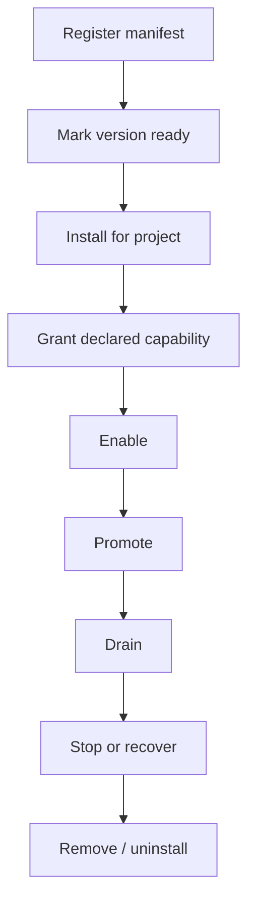

# Administrator guide

## Operating model

The Go host owns transport, project isolation, configuration, lifecycle, permission brokering, storage primitives, and worker supervision. Product behavior belongs to replaceable TypeScript plugins.

This separation is a release invariant: host changes must not embed auth, files, rooms, matchmaking, analytics, workflows, dashboard behavior, or other product capabilities directly in Go.

## Plugin lifecycle

Promotion rechecks readiness, configuration compatibility, grants, approvals, and pinned work. Removal and uninstall stop project workers and close project-scoped sockets.

## Authenticated admin API

### Local development

Run `make setup`, then `make dev` to launch Brain, the admin UI and four local Neurons. Use `make dev WORKERS=0` to start without Neurons, or `make dev WORKERS=6 WORKER_SLOTS=2` for a larger pool. Visit `/_system/ui/workers` in the admin UI to inspect connected Neurons, available slots, running work, queue depth, runtime profiles and heartbeat freshness. The managed pool executes manifest-selected plugin work through Cortex by default; the console also exposes bounded execution history and reported CPU/peak RSS. Confirm Drain/Resume to change scheduler placement, or use Stop/Start/Restart for Brain-managed local processes only. Stop and restart wait for admitted work to finish; a timed-out drain remains paused. A reconnect does not clear an operator pause within this Brain process lifetime. Remote process restarts remain the external supervisor's responsibility. With zero Neurons, application readiness is unavailable while operator recovery remains accessible. The legacy adapter is an explicit development comparison mode (`BRAIN_DEV_PLUGIN_EXECUTION=legacy`). Production defaults are unchanged. Ctrl+C stops the managed stack. Separate `make dev server` and `make dev admin` commands remain available. It uses SQLite at `.local/brain.sqlite` and creates the local operator `admin` with secret `secret` unless `OPERATOR_USERNAME` and `OPERATOR_SECRET` are explicitly provided. Never use these development defaults in production.

The packaged admin boundary uses a Go operator session in the trusted host. After operator authentication, send the returned session as `Authorization: Bearer <session>` to `POST /_system/admin/actions`. The host hashes session tokens, rejects missing, revoked, or expired sessions, and invalidates all operator sessions during recovery. Operator bearer sessions expire eight hours after issuance (not after the last request); sign in again when expired. Browser sign-out revokes the server session when the host is reachable. Destructive operations additionally require `"confirmed": true` and are audited.

## Current administration surface

See the [HTTP API](http-api.md), [runtime settings and troubleshooting](runtime-operations.md), [admin page contracts](admin-pages/README.md), and [function publication guide](functions-runtime.md). The packaged host currently uses SQLite; do not configure PostgreSQL application DSNs. Access Management is an opt-in additional deny-by-default policy; prepare rules and enroll deliberately.

## Security checklist

- Host-authenticate project identity before invoking a plugin.
- Never trust project IDs, grants, membership, or permissions from clients.
- Keep operator and end-user sessions separate.
- Keep runtime credentials unable to run DDL; use migration credentials for schema changes.
- Use parameterized SQL and validated identifiers.
- Keep secrets out of logs, images, bundles, fixtures, and diagnostics.
- Treat project IDs as untrusted input at plugin boundaries, including dashboard HTML and URL generation.
- Treat destructive actions as audited and protected by active-work checks.

## Local and release checks

Ordinary local checks use `go test ./...` and `go vet ./...`; they do not start Docker. PostgreSQL/Compose checks are explicit release or integration checks. Record the command, expected evidence, and rollback result before running them.

See the [deployment runbook](deployment-runbook.md) and [restore runbook](restore-runbook.md) for operational procedures.

## Observation delivery

A subscriber must be installed, ready and enabled in the same project and
granted its declared `observe.<publisher>.<event>` capability. Existing Analytics
installations need the new `observe.rooms.connected` grant; Subscriptions also
requires its declared observation and close capabilities. Review new capabilities
before granting them. Publisher and subscriber permissions and project activity
are rechecked before delivery; revoked or disabled subscriptions are dropped.

The production SQLite queue persists pending deliveries across restart, bounds
pending work to 1,000 per project / 10,000 globally, and retries transient
failures up to three attempts with backoff. Audit actions include
`observation_queued`, `observation_delivered`, `observation_retry`,
`observation_failed` and `observation_enqueue_failed`. Payloads are not written
to audit messages. Monitor queue failures; storage-backed writes fail closed
when their atomic outbox insert cannot be committed. Other host or memory-backed
actions use best-effort post-commit enqueue. Persisted receipts are project
scoped; protect and back up the SQLite file. Multiple host instances and
exactly-once delivery are not supported by this adapter.

The current Subscriptions polling adapter is operator-only and carries the
`rooms.connected` observation channel. It is not a substitute for end-user
WebSocket membership authorization.

## Game plugin separation

Rooms continues to own room creation, joining, reconnecting and generic results. Install and grant `games.modes` to enumerate supported game modes, or `pvp.describe` to discover reusable PvP features. These read-only project-bound routes do not create matches or grant access to player state. Existing room routes, capabilities, storage and observation names are unchanged; there is no room data migration. TypeScript callers must update game-specific imports from Rooms to Games and generic command deduplication imports to PvP.
\n## Project URL namespace and migration\n\nOpen the Next.js operator UI at `/_system/ui`. Authenticate through `/_system/admin/session` and manage the global catalog through `/_system/admin/projects` or `/_system/admin/plugins`. Select a project to navigate to its pages under `/{project}/ui/...`. The URL project ID or slug overrides browser session selection; API requests use `/{project}/admin/...`. Project identifiers in JSON, URLs and headers must agree. `project.create` accepts immutable `project_id`, display `name`, unique `slug`, and project `values` settings; `project.configure` can change name, slug or settings without changing storage identity. Existing projects use their IDs as slugs until configured. No root paths or `/public` aliases remain.\n

### Enrolled production Neurons (explicit Cortex mode)

Configure the Linux Brain process with `BRAIN_PLUGIN_EXECUTION=cortex`, `BRAIN_SYNAPSE_ADDRESS` (private host:port), `BRAIN_SYNAPSE_CERT`, `BRAIN_SYNAPSE_KEY`, `BRAIN_SYNAPSE_NEURON_CA`, and `BRAIN_SYNAPSE_ENROLLMENT` (paths to trusted files). The enrollment JSON maps each Neuron ID to an array of one or two lowercase `sha256:<64 hex digits>` fingerprints of its DER leaf certificate. Client certificates must carry the canonical URI SAN `spiffe://brain/neurons/<id>`, be signed by the configured Neuron CA, and be explicitly enrolled. Keep private keys outside plugin and sandbox paths; restrict Synapse at the network boundary to enrolled hosts. Run each Linux Neuron from the same verified release using `brain neuron connect --brain HOST:PORT --id ID --cert CLIENT_CERT --key CLIENT_KEY --ca BRAIN_CA --server-name BRAIN_DNS --runtime-root RELEASE_ROOT --slots 1 --enrolled-plugin-runtime`. The process starts with no Neurons and is not application-ready until compatible capacity connects. To rotate certificates, provision a new leaf, include both pins, restart Brain with the updated configuration, restart the Neuron with its new leaf, then remove the old pin and restart Brain. No live reload or automatic enrollment is provided. Runtime-source matching is not remote attestation; operators must trust the enrolled hosts and deploy verified images. This path is not yet a verified production rollout.
