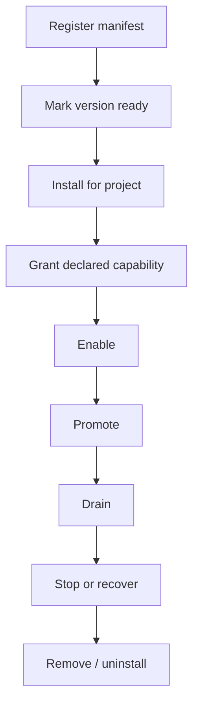

# Administrator guide

## Operating model

The Go host owns transport, project isolation, configuration, lifecycle, permission brokering, storage primitives, and worker supervision. Product behavior belongs to replaceable TypeScript plugins.

This separation is a release invariant: host changes must not embed auth, files, rooms, matchmaking, analytics, workflows, dashboard behavior, or other product capabilities directly in Go.

## Plugin lifecycle

Promotion rechecks readiness, configuration compatibility, grants, approvals, and pinned work. Removal and uninstall stop project workers and close project-scoped sockets.

## Authenticated admin API

### Local development

Run `./scripts/start-local.sh` from the repository root. It uses SQLite at `.local/brain.sqlite` and creates the local operator `admin` with secret `secret` unless `OPERATOR_USERNAME` and `OPERATOR_SECRET` are explicitly provided. Never use these development defaults in production.

The packaged admin boundary uses a Go operator session in the trusted host. After operator authentication, send the returned session as `Authorization: Bearer <session>` to `POST /admin/actions`. The host hashes session tokens, rejects missing or revoked sessions, and invalidates all operator sessions during recovery. Destructive operations additionally require `"confirmed": true` and are audited.

## Security checklist

- Host-authenticate project identity before invoking a plugin.
- Never trust project IDs, grants, membership, or permissions from clients.
- Keep operator and end-user sessions separate.
- Keep runtime credentials unable to run DDL; use migration credentials for schema changes.
- Use parameterized SQL and validated identifiers.
- Keep secrets out of logs, images, bundles, fixtures, and diagnostics.
- Treat project IDs as untrusted input at plugin boundaries, including dashboard HTML and URL generation.
- Treat destructive actions as audited and protected by active-work checks.

## Local and release checks

Ordinary local checks use `go test ./...` and `go vet ./...`; they do not start Docker. PostgreSQL/Compose checks are explicit release or integration checks. Record the command, expected evidence, and rollback result before running them.

See the [deployment runbook](deployment-runbook.md) and [restore runbook](restore-runbook.md) for operational procedures.
