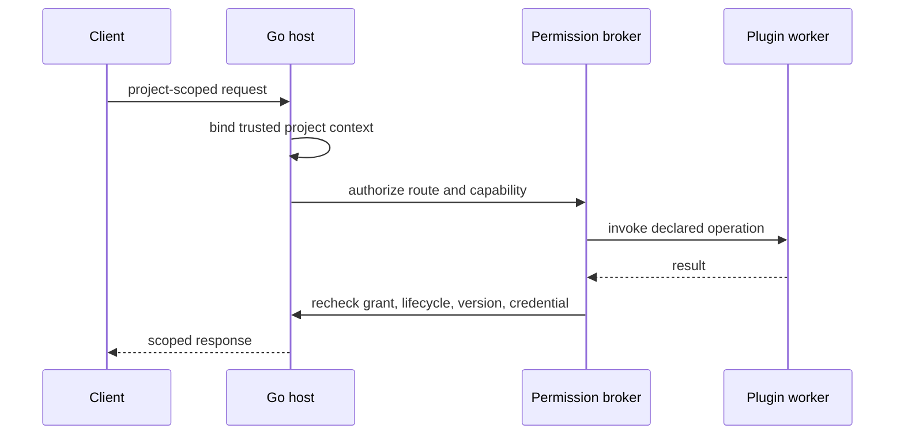

# Developer guide

## Quickstart

With Go, Node.js 20+, npm and Make installed, install the locked Node dependencies once:

```bash
make setup
```

Start the server and admin in separate terminals:

```bash
make dev server
make dev admin
```

The Go server listens on `http://127.0.0.1:18082` and uses local SQLite storage at `.local/brain.sqlite`. The Next.js admin listens on `http://127.0.0.1:3000` and proxies to the server. Stop either process with Ctrl+C. The local startup script supports `HTTP_ADDRESS`, `PROJECTS_FILE`, `OPERATOR_USERNAME` and `OPERATOR_SECRET` overrides. The admin supports `ADMIN_HOST`, `ADMIN_PORT` and `BRAIN_API_ORIGIN`, for example:

```bash
make dev server HTTP_ADDRESS=127.0.0.1:18090
make dev admin ADMIN_PORT=3100 BRAIN_API_ORIGIN=http://127.0.0.1:18090
```

Development requires no Docker on macOS or Linux. On macOS, `make dev server` selects the built-in Seatbelt (`/usr/bin/sandbox-exec`) worker adapter, with loopback-only HTTP, an allowlist of readable runtime/plugin paths, denied network access, and bounded heap/invocation time. This is a local-development adapter for trusted checkout code, not Linux-equivalent production isolation; Seatbelt's command-line interface is deprecated, and macOS does not enforce the same address-space or process limits. Startup fails closed if the adapter cannot run. On Linux (including WSL2), install bubblewrap and enable user namespaces; the Linux production sandbox is unchanged. Do not use the local script's default credentials in production.

Run the development checks:

```bash
GOCACHE=/tmp/brain-go-cache go test ./...
go vet ./...
go test -race ./tests/operator
npm ci
npm run lint:ts
npm run typecheck
npm run test:ts
(cd admin-nextjs && npm ci && npm run typecheck)
```

These commands do not start Docker. Use Docker/Compose only for an explicit PostgreSQL or release integration check.

## Plugin contract

Every product capability is a TypeScript plugin:

```text
plugins/<plugin-id>/
  index.ts
  plugin.yaml
```

`plugin.yaml` is authoritative for title, description, version, routes, functions, capabilities, source files, imports, and plugin dependencies. Every source and runtime import must be declared. `index.ts` is the public boundary; cohesive modules own related responsibilities and reuse shared SDK helpers.

The Go host does not implement product capabilities. Keep product behavior in `plugins/<plugin-id>/`; keep Go host changes limited to shared infrastructure, lifecycle, permissions, storage primitives, worker supervision, and versioned contracts.

Example:

```yaml
id: notes
version: 1.0.0
host_api: 1
entrypoint: index.ts
source_files:
  - index.ts
imports:
  - ../sdk-typescript/src/index.js
capabilities:
  - notes.read
routes:
  - operation: notes.list
    function: listNotes
    capability: notes.read
```

## Shared boundaries

- Go: `internal/plugin/registry_*.go` separates lifecycle, catalog, permissions,
  invocation, storage, and worker management. Keep behavior in the owning module
  rather than adding another registry-wide helper.
- Persistence: bind a `RegistryStateStore` and an `InvocationStoragePlanner`
  during host setup. A planner must preserve the trusted request identity and
  prepare writes without performing them. The registry commits only after a
  successful worker response and a second authorization check. The existing
  SQLite product adapter is transitional; see [refactoring notes](refactoring.md).
- TypeScript: use the SDK route and host-context validation instead of resolving
  operations separately in each handler.
- Admin: use `app/lib/admin-api.ts` for session/request handling,
  `admin-navigation.ts` for visibility, and focused components for page rendering.
  The root page coordinates state and actions; do not duplicate console flows.
- Clients: enforce the host's project ID grammar before transport; this validation
  does not replace host authorization.

## Request flow



## TDD workflow

1. Read `AGENTS.md` and the active `.agents/phase-XX.md` guide.
2. Decompose affected plugin code before extending it.
3. Add one focused failing test under `tests/`.
4. Implement the smallest passing change.
5. Run focused tests, affected package tests, race tests, lint, and the full suite.
6. Update the relevant roadmap checkbox only after verification.
7. Update developer/admin docs and the newest-first per-commit changelog.
8. Commit one focused checkbox and push it.

## Safety boundaries

- Never authorize from client payloads, route parameters, object keys, or plugin-supplied project IDs.
- Keep all tests under top-level `tests/`.
- Keep secrets out of logs, fixtures, screenshots, and diagnostics.
- Validate project IDs before using them in generated HTML, URLs, storage keys, or other structured output.
- Use parameterized SQL and validated identifiers.
# Cross-cutting UI and API changes

Themes, UI kinds, API errors, warnings, informational messages, and toast behavior are project-wide contracts. Implement them in shared host/SDK/UI boundaries, then audit every plugin, function, class, API handler, admin page, client, manifest, and test fixture before marking the change complete. Keep one canonical response/message shape and add a cross-surface regression test.

## Shared TypeScript plugin SDK

Plugin manifests may select the allowlisted route helper `sdk.dispatch`:

```yaml
routes:
  - operation: files.metadata
    function: metadata
    helper: sdk.dispatch
    capability: files.metadata
```

The host validates the helper name and route capability, carries the helper into the execution descriptor, and checks the request's project, plugin, version, and declared operation before dispatch. The plugin exports `dispatchRoute` from its entrypoint. Use `createRouteDispatcher` for named domain handlers or `createOperationRoutes` for several operations with the same implementation boundary. For a handler that needs the host-validated RPC context (such as Auth), select `helper: sdk.request` and export `dispatchRequest` built with `createRequestDispatcher`. Unknown helpers and handlers are rejected; YAML cannot import arbitrary modules or execute expressions. Existing routes without a helper continue to use their existing dispatch behavior.

Use the SDK at `plugins/sdk-typescript/src/index.ts` for common string validation, project-partitioned in-memory maps, bounded retries, timeouts, and commit-time grant checks. Functions uses the same helpers. A project map is not an authorization mechanism; host-authenticated context and the permission broker remain authoritative. A timeout does not cancel the underlying task; worker supervision enforces execution limits.

Keep cohesive operations in one domain module, remove unused wrapper files, update the manifest's source and import lists, and retain tests under the top-level `tests/` directory.

### Declarative response routes

Use `helper: sdk.response` for routes that only validate input and map a response. Declare `response.input` as an ordered list of fields with `name`, `type: string|value`, optional `trim`, string `default`, and `required` with an `error` message. Declare `response.output` as scalar constants or references such as `$input.name`. Missing value fields become null. The host validates the bounded schema; the worker rejects unknown references and applies the same project/operation checks as custom handlers. This helper cannot execute arbitrary expressions or perform writes. Keep authorization, storage and other side effects in trusted host APIs or custom handlers. Functions invoke/publish use this helper; their direct TypeScript exports remain for compatibility.

### Compact plugin domains

Prefer a small number of cohesive domain modules (accounts/sessions, compiler/invocation, schema/records, directory/gameplay, etc.) rather than a file per method. Import public plugin APIs through `index.ts`; individual source paths are internal. Use `createResourceRequest` for repeated resource-specific RPC request builders, `createFixedWindowLimiter` for in-memory rate policies, and `validateBoundedInteger` / `requireAllowedValues` for shared validation. These helpers do not authorize a request. Preserve the host project, capability, and commit boundaries. The manifest inventory test checks that every TypeScript source is declared, and the existing contract and behavioral tests continue to exercise the exported APIs.

### Project-bound functions and observation hooks

New worker functions use `helper: sdk.context` and the signature
`(context: PluginContext, input: unknown)`. The host resolves the active project
and injects its read-only projection (`context.project.id`, `context.project.active`),
the authenticated plugin/version, execution operation, and observation API.
Use `requireProjectInput(context, input)` for object input validation. The
older dispatch helpers receive the same context at the worker boundary;
request serializers and pure domain utilities are not authorization boundaries.

Declare the publisher's event schema:

```yaml
events:
  - name: connected
    fields:
      roomId: string
      reconnected: boolean
```

Publish only after a real domain action succeeds:

```ts
context.plugins.observe.fire("connected", { roomId, reconnected: false });
```

The host supplies the publisher identity, project and stable event ID. The
subscriber declares its own grant and handler, with no source-code import of
the publisher:

```yaml
capabilities:
  - observe.rooms.connected
observe:
  - plugin: rooms
    event: connected
    function: observeRoomConnected
    capability: observe.rooms.connected
    persist: true
```

The handler receives its own trusted context and an `Observation<T>` containing
the publisher plugin, version, event, project, ID and typed payload. Persisted
receipts are optional; do not recursively fire from observer handlers. Event
fields must be bounded scalar values, exactly match the schema and exclude
credentials, raw file contents and arbitrary records. `source: host` is reserved
for successful trusted host effects such as dashboard lifecycle actions and
function publication. `host.admin` routes are not worker-callable.

The SQLite adapter commits durable plugin writes and observation queue inserts
in one transaction; the host drains committed events asynchronously with
bounded retries and reauthorization. A subscriber must handle possible duplicate
delivery using the event ID. The queue is single-host, not a distributed
exactly-once mechanism. In-memory actions and existing host lifecycle/function
writes still enqueue after their commit, without an atomic outbox guarantee.
For scheduling and workflow libraries use the `bindProjectSchedule`,
`bindProjectTriggers`, `bindProjectJobLeases` and `runProjectWorkflow` helpers.
These bindings do not themselves implement a production job runner.

## Rooms, games and PvP boundaries

- `rooms` owns room lifecycle, membership, connection tickets, generic room results and room observations. It has no game-mode exports.
- `games` owns mode-specific state, rules, commands, outcome detection and adapters. Import Tic-Tac-Toe from `plugins/games/index.ts`; the project-bound `games.modes` route lists available modes.
- `pvp` exposes reusable turn rotation, deadlines, pause/resume, revision-checked commands, replay, deduplication, membership checks and private views. Its `pvp.describe` route reports the supported primitives. The pure implementations are in the trusted SDK (`src/pvp.ts`) so isolated game workers do not import sibling plugin files. These helpers are not a substitute for host-authenticated context, actor grants or durable state.

Existing room HTTP operations and events are unchanged. The two new discovery routes require their own capabilities. Game mechanics are local TypeScript APIs, not a new network-accessible match service. Add new game modes in `games` without modifying `rooms` or copying PvP primitives.
