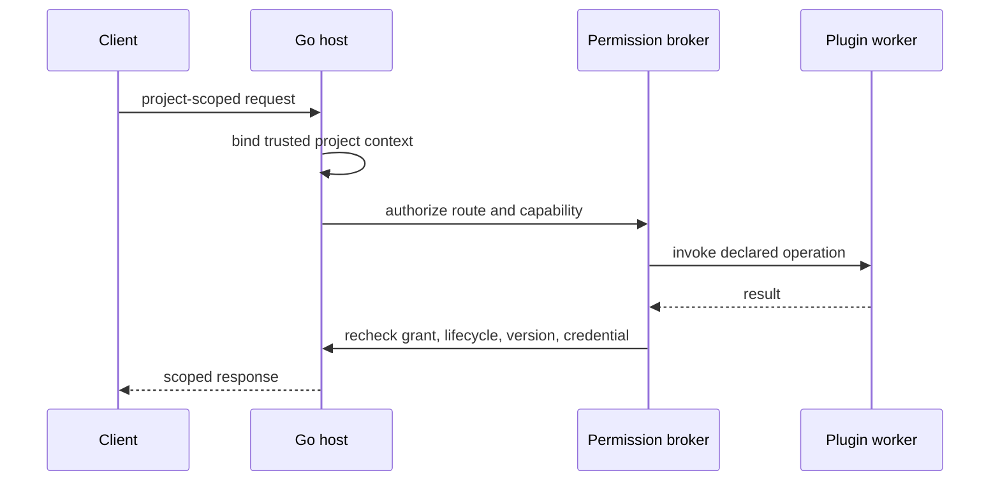

# Developer guide

## Quickstart

```bash
GOCACHE=/tmp/brain-go-cache go test ./...
go vet ./...
npm run lint:ts
npm run typecheck
npm run test:ts
```

These commands do not start Docker. Use Docker/Compose only for an explicit PostgreSQL or release integration check.

## Plugin contract

Every product capability is a TypeScript plugin:

```text
plugins/<plugin-id>/
  index.ts
  plugin.yaml
```

`plugin.yaml` is authoritative for title, description, version, routes, functions, capabilities, source files, imports, and plugin dependencies. Every source and runtime import must be declared. `index.ts` is the public boundary; focused files own one callable responsibility.

Example:

```yaml
id: notes
version: 1.0.0
host_api: 1
entrypoint: index.ts
source_files:
  - index.ts
imports:
  - ../sdk-typescript/src/index.js
capabilities:
  - notes.read
routes:
  - operation: notes.list
    function: listNotes
    capability: notes.read
```

## Request flow



## TDD workflow

1. Read `AGENTS.md` and the active `.agents/phase-XX.md` guide.
2. Decompose affected plugin code before extending it.
3. Add one focused failing test under `tests/`.
4. Implement the smallest passing change.
5. Run focused tests, affected package tests, race tests, lint, and the full suite.
6. Update the relevant roadmap checkbox only after verification.
7. Update developer/admin docs and the newest-first per-commit changelog.
8. Commit one focused checkbox and push it.

## Safety boundaries

- Never authorize from client payloads, route parameters, object keys, or plugin-supplied project IDs.
- Keep all tests under top-level `tests/`.
- Keep secrets out of logs, fixtures, screenshots, and diagnostics.
- Use parameterized SQL and validated identifiers.
