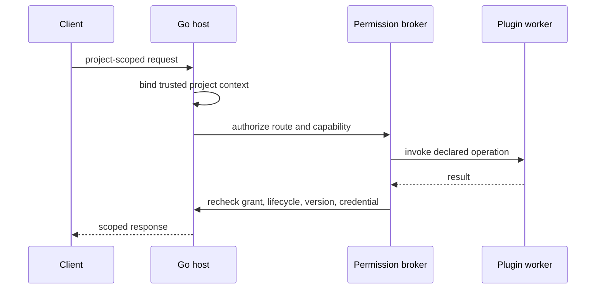

# Developer guide

## Quickstart

```bash
GOCACHE=/tmp/brain-go-cache go test ./...
go vet ./...
go test -race ./tests/operator
npm ci
npm run lint:ts
npm run typecheck
npm run test:ts
(cd admin-nextjs && npm ci && npm run typecheck)
```

These commands do not start Docker. Use Docker/Compose only for an explicit PostgreSQL or release integration check.

## Plugin contract

Every product capability is a TypeScript plugin:

```text
plugins/<plugin-id>/
  index.ts
  plugin.yaml
```

`plugin.yaml` is authoritative for title, description, version, routes, functions, capabilities, source files, imports, and plugin dependencies. Every source and runtime import must be declared. `index.ts` is the public boundary; cohesive modules own related responsibilities and reuse shared SDK helpers.

The Go host does not implement product capabilities. Keep product behavior in `plugins/<plugin-id>/`; keep Go host changes limited to shared infrastructure, lifecycle, permissions, storage primitives, worker supervision, and versioned contracts.

Example:

```yaml
id: notes
version: 1.0.0
host_api: 1
entrypoint: index.ts
source_files:
  - index.ts
imports:
  - ../sdk-typescript/src/index.js
capabilities:
  - notes.read
routes:
  - operation: notes.list
    function: listNotes
    capability: notes.read
```

## Shared boundaries

- Go: `internal/plugin/registry_*.go` separates lifecycle, catalog, permissions,
  invocation, storage, and worker management. Keep behavior in the owning module
  rather than adding another registry-wide helper.
- Persistence: bind a `RegistryStateStore` and an `InvocationStoragePlanner`
  during host setup. A planner must preserve the trusted request identity and
  prepare writes without performing them. The registry commits only after a
  successful worker response and a second authorization check. The existing
  SQLite product adapter is transitional; see [refactoring notes](refactoring.md).
- TypeScript: use the SDK route and host-context validation instead of resolving
  operations separately in each handler.
- Admin: use `app/lib/admin-api.ts` for session/request handling,
  `admin-navigation.ts` for visibility, and focused components for page rendering.
  The root page coordinates state and actions; do not duplicate console flows.
- Clients: enforce the host's project ID grammar before transport; this validation
  does not replace host authorization.

## Request flow



## TDD workflow

1. Read `AGENTS.md` and the active `.agents/phase-XX.md` guide.
2. Decompose affected plugin code before extending it.
3. Add one focused failing test under `tests/`.
4. Implement the smallest passing change.
5. Run focused tests, affected package tests, race tests, lint, and the full suite.
6. Update the relevant roadmap checkbox only after verification.
7. Update developer/admin docs and the newest-first per-commit changelog.
8. Commit one focused checkbox and push it.

## Safety boundaries

- Never authorize from client payloads, route parameters, object keys, or plugin-supplied project IDs.
- Keep all tests under top-level `tests/`.
- Keep secrets out of logs, fixtures, screenshots, and diagnostics.
- Validate project IDs before using them in generated HTML, URLs, storage keys, or other structured output.
- Use parameterized SQL and validated identifiers.
# Cross-cutting UI and API changes

Themes, UI kinds, API errors, warnings, informational messages, and toast behavior are project-wide contracts. Implement them in shared host/SDK/UI boundaries, then audit every plugin, function, class, API handler, admin page, client, manifest, and test fixture before marking the change complete. Keep one canonical response/message shape and add a cross-surface regression test.

## Shared TypeScript plugin SDK

Plugin manifests may select the allowlisted route helper `sdk.dispatch`:

```yaml
routes:
  - operation: files.metadata
    function: metadata
    helper: sdk.dispatch
    capability: files.metadata
```

The host validates the helper name and route capability, carries the helper into the execution descriptor, and checks the request's project, plugin, version, and declared operation before dispatch. The plugin exports `dispatchRoute` from its entrypoint. Use `createRouteDispatcher` for named domain handlers or `createOperationRoutes` for several operations with the same implementation boundary. For a handler that needs the host-validated RPC context (such as Auth), select `helper: sdk.request` and export `dispatchRequest` built with `createRequestDispatcher`. Unknown helpers and handlers are rejected; YAML cannot import arbitrary modules or execute expressions. Existing routes without a helper continue to use their existing dispatch behavior.

Use the SDK at `plugins/sdk-typescript/src/index.ts` for common string validation, project-partitioned in-memory maps, bounded retries, timeouts, and commit-time grant checks. Functions uses the same helpers. A project map is not an authorization mechanism; host-authenticated context and the permission broker remain authoritative. A timeout does not cancel the underlying task; worker supervision enforces execution limits.

Keep cohesive operations in one domain module, remove unused wrapper files, update the manifest's source and import lists, and retain tests under the top-level `tests/` directory.

### Declarative response routes

Use `helper: sdk.response` for routes that only validate input and map a response. Declare `response.input` as an ordered list of fields with `name`, `type: string|value`, optional `trim`, string `default`, and `required` with an `error` message. Declare `response.output` as scalar constants or references such as `$input.name`. Missing value fields become null. The host validates the bounded schema; the worker rejects unknown references and applies the same project/operation checks as custom handlers. This helper cannot execute arbitrary expressions or perform writes. Keep authorization, storage and other side effects in trusted host APIs or custom handlers. Functions invoke/publish use this helper; their direct TypeScript exports remain for compatibility.
