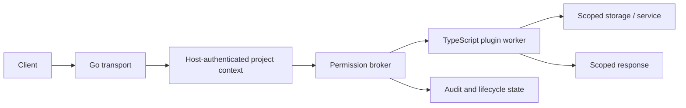

# Brain documentation

PROJECT-ISOLATED BACKEND · PLUGIN PLATFORM

## Build apps, websites, and games on a composable backend.

Brain combines a Go host with versioned TypeScript plugins, scoped storage, and a single operator control plane. Build a feature as a plugin; let the host enforce project identity, lifecycle, and access.

[Get started](developers.md){ .md-button .brain-primary } [Operate Brain](admins.md){ .md-button .brain-secondary }

## Architecture at a glance

- **Trusted host**

    Go owns transport, identity, authorization, project storage, and lifecycle.

    [HTTP API and host routes](http-api.md)

- **Versioned plugins**

    TypeScript and declarative plugins expose explicit, manifest-defined operations and observation hooks.

    [Plugin communication](plugin-communication.md)

- **One control plane**

    The admin UI exposes only the installed, ready, and authorized capabilities of each project.

    [Administration guide](admins.md)

- **Portable clients**

    Browser, Flutter and Kotlin clients use the same project-scoped protocol.

    [Browser quickstart](browser-quickstart.md)

## System flow

The plugin never supplies the authoritative project identity. The host binds it before authorization and rechecks lifecycle, grants, versions, and single-use invocation credentials at commit time.

## Start with a clear boundary

!!! tip "Local development"
    Do not run Docker during ordinary local development. Use in-process tests and SQLite-compatible local checks. PostgreSQL and Compose checks are explicit integration or release work.

- [Deployment runbook](deployment-runbook.md): release checks and rollback evidence.
- [Restore runbook](restore-runbook.md): recovery procedures.
- [Phase options](phase-options.md): decisions and alternatives.
- [Quality and coverage](quality.md): reproducible checks and coverage targets.
