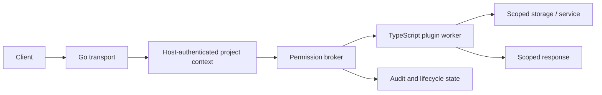

# Brain documentation

Brain is a project-isolated Go backend host with replaceable TypeScript plugins.

## Choose a path

- [Developers](developers.md): local setup, plugin contracts, TDD, and verification.
- [Administrators](admins.md): lifecycle, security, recovery, and operating rules.
- [Plugin communication](plugin-communication.md): versioned host/worker flow.
- [Deployment runbook](deployment-runbook.md): release checks and rollback evidence.
- [Restore runbook](restore-runbook.md): recovery procedures.
- [Phase options](phase-options.md): decisions and alternatives.

## System flow

The plugin never supplies the authoritative project identity. The host binds it before authorization and rechecks lifecycle, grants, versions, and single-use invocation credentials at commit time.

## Local rule

Do not run Docker during ordinary local development. Use in-process tests and SQLite-compatible local checks. PostgreSQL and Compose checks are explicit integration or release work.

## Quality

See the [quality and coverage guide](quality.md) for reproducible checks and coverage targets.
